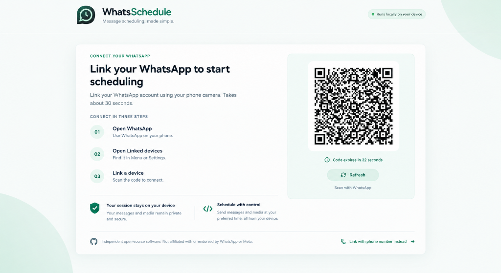

<div align="center">


# WhatsSchedule

### **Your Messages. Your Time. Message Scheduling, Made Simple.**

An independent, local-first open-source scheduler for WhatsApp messages, HD videos, photos, voice memos, and documents.

[](LICENSE)
[](https://www.typescriptlang.org/)
[](https://react.dev)
[](https://vite.dev)
[](https://tailwindcss.com/)
[](docker-compose.yml)
[](CONTRIBUTING.md)

<br />



</div>

---

## 🌟 Why WhatsSchedule?

Have you ever thought of an important message at night—like asking HR about your salary or sending a project update to a client—but didn't want to send it at 11:00 PM or risk forgetting it at 9:00 AM?

**WhatsSchedule solves this completely.** It links directly to your WhatsApp account on your device and automatically dispatches messages, videos, documents, or voice notes at the exact date and time you choose.

* **🔒 100% Local & Private**: Runs on your own machine. Your messages, contacts, and session keys are never sent to third-party tracking servers.
* **🌓 Complete Light & Dark Themes**: Fully designed light mode (`#F6F9F7` / `#087F5B`) and charcoal-green dark mode (`#101815` / `#25C993`) that sync with your system preferences.
* **🤖 Built-in AI Assistant**: Draft professional follow-ups, friendly reminders, or formal announcements with 1 click.
* **📱 Apple & Android Friendly**: Full native support for iPhone QuickTime `.mov` videos, `.heic` photos, voice notes, and PDFs up to 100 MB.
* **✓✓ Live Delivery Status**: See single ticks (sent), double grey ticks (delivered to phone), and double blue ticks (read by recipient) in real-time.
* **🛡️ Master PIN Security**: Protects your session with zero-knowledge PBKDF2 encryption (100,000 rounds) so other users or browser profiles cannot see your chats.

---

## 🚀 How to Use WhatsSchedule (In 3 Simple Steps)

### Step 1: Link Your WhatsApp (30 seconds)
1. Start WhatsSchedule and open `http://localhost:5001`.
2. Open WhatsApp on your phone $\to$ go to **Settings** (or 3 dots on Android) $\to$ tap **Linked devices** $\to$ **Link a device**.
3. Point your phone camera at the on-screen QR code. You're connected!

### Step 2: Choose Your Contact & Date
1. Click **+ Add Schedule** or the message icon in the sidebar.
2. Select an existing contact from your synced chat list, or type any phone number with country code (e.g. `+1 555-0192` or `+92 300-1234567`).
3. Pick your desired date and time, or tap instant presets like **+15 Mins**, **+1 Hour**, or **Tomorrow 9am**.

### Step 3: Type or AI-Draft Your Message & Schedule
1. Type your message, or click **AI Assist Draft** to write a polished message automatically.
2. *(Optional)* Attach photos, videos, or documents.
3. Tap **Schedule WhatsApp Message**. The background queue takes care of the rest!

---

## ⚡ Quick Start Options

### Option A: 1-Click Launch (No Terminal Knowledge Required)

* **Mac & Linux**: Double-click or run `./start.sh` in Terminal. It automatically prepares packages and opens your browser.
* **Windows**: Double-click `start.bat`.

### Option B: Docker Compose

```bash
# Clone the repository
git clone https://github.com/AroonKumarr/whatschedule.git
cd whatschedule

# Start container in background
docker compose up -d
```
Open **`http://localhost:5001`** in your browser.

### Option C: Developer Setup

```bash
# Clone the repository
git clone https://github.com/AroonKumarr/whatschedule.git
cd whatschedule

# Install dependencies for both server and client
npm run install:all

# Start both backend and frontend development servers concurrently
npm run dev
```

---

## 📱 Mobile App Setup (iPhone & Android — Free)

WhatsSchedule is packaged as a standalone **Progressive Web App (PWA)**:

* **iPhone (iOS Safari)**: Open `http://<your-computer-ip>:5001` in Safari $\to$ tap **Share** (⎙) $\to$ select **Add to Home Screen**. Launches full-screen like a native app.
* **Android (Google Chrome)**: Open Chrome $\to$ tap the **three dots (⋮)** $\to$ tap **Install App**.

---

## 🎨 Brand Color Tokens

WhatsSchedule uses a distinctive, trademark-safe brand identity based on emerald and forest greens:

| Token | Light Theme | Dark Theme | Purpose |
| :--- | :--- | :--- | :--- |
| **Page Background** | `#F6F9F7` | `#101815` | Soft, glare-free canvas |
| **Main Surface** | `#FFFFFF` | `#17211D` | Primary card and content elevation |
| **Secondary Surface**| `#F0F5F2` | `#1E2B25` | QR container, search, and table rows |
| **Primary Accent** | `#087F5B` | `#25C993` | Buttons, links, active indicators |
| **Primary Text** | `#16231F` | `#F2F7F4` | High-contrast readable typography |
| **Borders** | `#DCE7E1` | `#2D3D35` | Thin dividers and component frames |

---

## 🔒 Privacy & Safety Guarantee

* **No Secret Cloud Backdoors**: Your session tokens stay in local `./sessions/` storage on your computer.
* **Zero Private Message Scraping**: WhatsSchedule never downloads or stores your personal chat histories. It only interacts with the messages you explicitly schedule.
* **API Key Safety**: Your personal environment keys (`.env`) are strictly git-ignored and never committed or transmitted.

---

## 🤝 Contributing

We love contributions from developers of all skill levels!
* Read [`CONTRIBUTING.md`](CONTRIBUTING.md) to get started with pull requests and issues.
* Read [`DEVELOPER_GUIDE.md`](DEVELOPER_GUIDE.md) for full architecture and Baileys multi-device protocol details.

---

## ⚖️ Legal & Trademark Notice

* **Independent Software**: WhatsSchedule is an independent open-source productivity tool authored and maintained by **Aroon Kumar**.
* **Trademark Disclaimer**: WhatsApp is a registered trademark of **Meta Platforms, Inc.** WhatsSchedule is not endorsed by, sponsored by, or affiliated with WhatsApp LLC or Meta Platforms, Inc.

---

<div align="center">

**⭐ If WhatsSchedule saves you time, please star this repository! ⭐**

Crafted with care by [Aroon Kumar](https://github.com/AroonKumarr)

</div>
